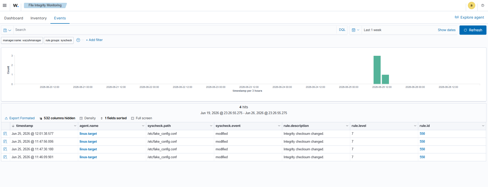
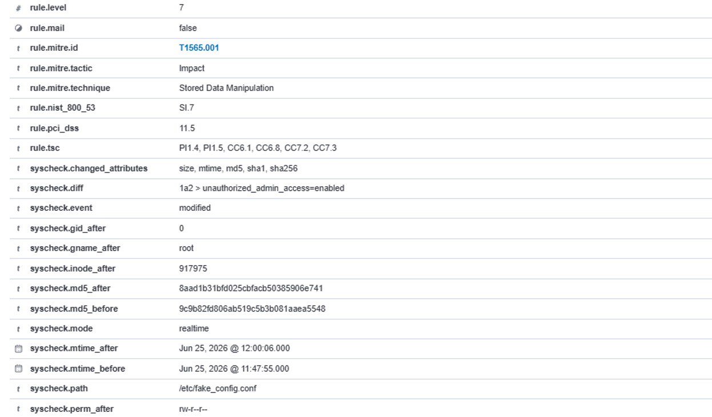
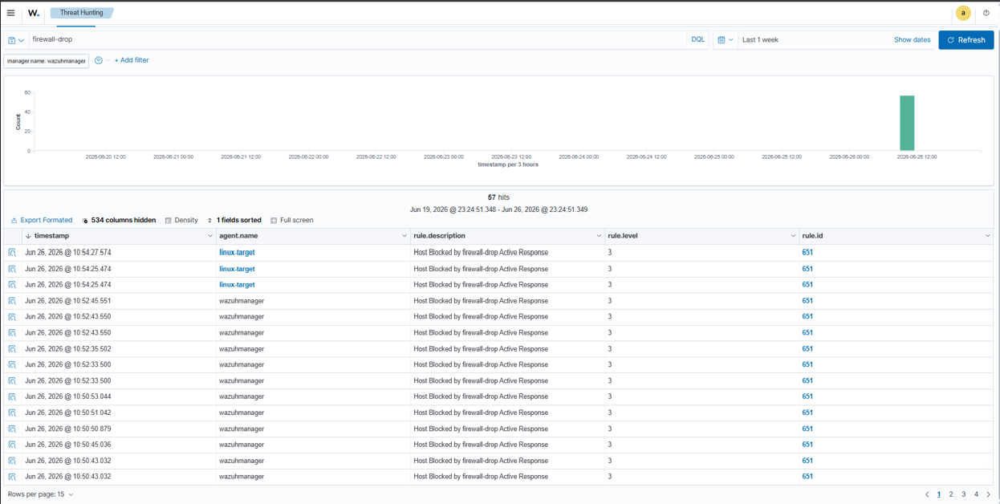

# Wazuh SIEM & Active Response Lab

A two-VM home lab where I set up Wazuh to monitor a Linux endpoint, detect file tampering in real time, and automatically block brute-force attackers at the firewall. I then attacked my own setup to check that each defence worked, as a small purple-team exercise. Built in June 2026.

The real configuration files from both machines are in [`config-backups/`](config-backups/).

---

## Lab setup

Two Ubuntu VMs in Oracle VirtualBox, connected over a host-only network:

* **wazuhmanager** (Ubuntu Server, `192.168.56.10`): runs the Wazuh manager, indexer and dashboard. It collects and analyses the agent's events, raises alerts and triggers active responses.
* **linux-target** (Ubuntu): the monitored endpoint, running the Wazuh agent and reporting to the manager.

---

## What I built

### 1. Configuration assessment

* Ran Wazuh's Security Configuration Assessment (SCA) on the agent, which checks it against CIS benchmark policies.
* Reviewed the failed checks, such as unnecessary open ports, alongside Wazuh's vulnerability detection results for missing OS patches.

### 2. Real-time file integrity monitoring with diffs

By default, Wazuh's file integrity monitoring (`syscheck`) scans every 12 hours. On the agent, I switched it to real-time monitoring of key system folders and turned on `report_changes`, so each alert shows exactly what changed in the file:

```xml
<directories realtime="yes" report_changes="yes">/etc,/usr/bin,/usr/sbin</directories>
```

### 3. Automated active response

On the manager, I configured two active responses. Each runs Wazuh's `firewall-drop` script, which blocks the attacker's IP address with `iptables` for 600 seconds (10 minutes):

```xml
<active-response>
  <command>firewall-drop</command>
  <location>local</location>
  <rules_id>5712</rules_id>
  <timeout>600</timeout>
</active-response>

<active-response>
  <command>firewall-drop</command>
  <location>local</location>
  <level>10</level>
  <timeout>600</timeout>
</active-response>
```

* The first fires on rule 5712, Wazuh's built-in rule for an SSH brute-force attempt.
* The second fires on any alert of level 10 or higher, which covers other repeated authentication failures (for example through PAM or `su`).
* `location` is set to `local`, so the block runs on the machine that raised the alert.

---

## Results

### 1. Real-time FIM alert



I modified a test file, `/etc/fake_config.conf`, on linux-target. The agent detected the change immediately, and the manager raised rule 550 ("Integrity checksum changed", level 7).

### 2. File content diff



Because `report_changes` is on, the alert's `syscheck.diff` field shows the exact line I added to simulate an attacker: `unauthorized_admin_access=enabled`. The alert also records the file's hashes before and after, and Wazuh maps the event to MITRE ATT&CK T1565.001 (Stored Data Manipulation). That gives an investigator what changed, not just that something changed.

### 3. Active response block



After repeated failed logins, the dashboard shows rule 651 events ("Host Blocked by firewall-drop Active Response"). Each one is an IP that Wazuh blocked automatically, without manual action.

---

## What I learned

* **Wazuh configuration:** how the manager's and the agent's `ossec.conf` divide the work, and how rule IDs and alert levels drive alerts and responses.
* **Scheduled vs real-time FIM:** real-time monitoring catches tampering as it happens, and diffs turn an alert into something you can investigate.
* **The risk of automated blocking:** a 10-minute block on every level 10+ alert could lock out a legitimate user who mistypes a password. In production I'd tune the trigger rules and whitelist trusted admin IPs.

## Limitations and next steps

* Agents enroll without a password (`use_password` is `no`), which is fine for an isolated lab. In production I'd require enrollment authentication.
* Part 2 is planned: detection engineering with Sysmon, Atomic Red Team and Sigma rules, mapped to MITRE ATT&CK.
